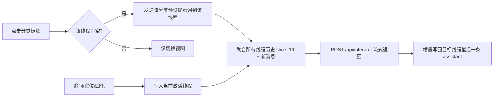

## 产品概述

将紫微命盘页面的 AI 解读面板从「单条长对话」改为「按分类独立对话线程」的交互模型。

## 核心需求

用户原话：「我想點一個範疇時, 會轉去新一個的對話窗,不是一直加長對話,當然系統是會讀取所有對話 : 命格 八字 感情 事業 財運 健康 性格」

## 功能内容

1. **独立对话窗**：7 个分类标签（命格/八字/感情/事業/財運/健康/性格）各自拥有独立的对话线程；点击标签即切换到该分类自己的对话窗，而不是往同一条对话里不断追加。
2. **首次进入自动生成**：某分类第一次被点开且尚无内容时，自动以该分类的预设提示词生成解读（保持现有 hidden 提示词不显示用户气泡的行为）；已有内容的分类再次点击仅切换视图，不重复请求。
3. **全局上下文**：发送任何问题时，AI 请求的 messages 由**所有线程的对话历史汇总**而成（系统仍读取所有对话），而不是只带当前线程。
4. **追问归属当前线程**：输入框的追问、宫位点击分析、四化飞化分析都注入到当前激活分类的线程中，各自独立延续。
5. **UI 细化**：空态文案随分类动态变化（如「感情解讀生成中…」）；已生成内容的标签可加一个小圆点指示；标签按钮在加载中时禁用（沿用现有 loading 防并发）。

## 边界与约束

- 后端 `/api/interpret` 不改动（仍接收 `messages` 数组，上限 20 条 / 28k 字符），上下文聚合需遵守该上限。
- 宫位/四化自动注入与手动追问共用同一套线程模型，不得破坏现有 hidden 气泡与流式渲染逻辑。
- 保持繁体中文展示、AiContent 的 markdown 渲染行为不变。

## 技术方案

### 技术栈

- 沿用现有 Next.js 16 (Turbopack) + React 19 + TypeScript + framer-motion，不引入新依赖。
- 仅修改 `components/InsightPanel.tsx`；清理 `app/layout.tsx` 与临时诊断文件（前次调试遗留）。

### 实现思路

1. **状态模型重构**：将单一 `messages: Message[]` 改为 `threads: Record<TopicKey, Message[]>` + `activeTopic`。每个分类一个独立数组，`hidden` 字段语义不变。
2. **线程切换与首次生成**：`handleTopicClick(key)` 只做 `setActiveTopic(key)`；若目标线程为空则触发 `sendMessage(TOPIC_PROMPTS[key], hidden=true)`（写入该线程）。初始挂载时保留「自动生成命格總覽」的行为，写入 `overview` 线程。
3. **全局上下文聚合**：发送时按 TOPICS 顺序遍历所有线程，每线程取最近若干条（如 4 条），合并后整体 `slice(-19)`，再追加本次 user 消息，确保总数 ≤ 20（后端 MAX_MESSAGES=20）；沿用现有 `MAX_TOTAL_CHARS` 由后端校验。
4. **流式回写定位到线程**：`streamResponse` 增加 `topicKey` 参数，流式增量只更新对应线程的最后一条 assistant 消息；用 `activeTopicRef`/参数传递避免闭包过期；错误文案同样写入该线程。
5. **并发防护**：沿用 `loadingRef` 全局单飞——任一线程生成中时，其他标签点击与追问均被禁用/忽略，避免流式写入串线程。
6. **注入行为**：宫位选中、四化飞化的自动分析 `sendMessage(prompt, true, activeTopic)` 注入当前激活线程。
7. **UI**：空态文案改为 `${当前分类label}解讀生成中…`；有内容的标签渲染一个小圆点指示；加载中标签 `disabled` 不变。
8. **清理**：删除 `components/ErrorProbe.tsx`、`app/api/diag/route.ts`，并移除 `app/layout.tsx` 中的引用（前次排查 getBoundingClientRect 的临时探针）。

### 架构图

### 性能与可靠性

- 上下文聚合为 O(线程数 × 每线程截取数)，量级恒定（7 × 4 + 1），无性能瓶颈。
- 请求仍全局单飞，防止多线程流式交错写错；错误处理、`AbortSignal` 超时（后端已有）保持不变。
- 不改动后端与数据结构契约，向前兼容；ChatPanel.tsx 为未使用的旧组件，本次不动。